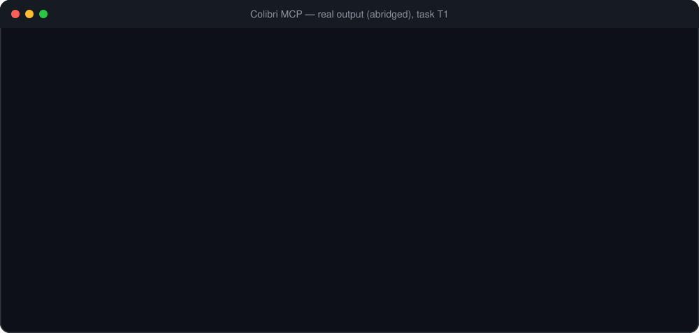

<div align="center">



<h3>🐦 The hummingbird browser for AI agents — tiny, fast, precise.<br/>Same tasks. <b>89× fewer tokens</b> than screenshots, <b>11× fewer</b> than Playwright MCP.</h3>

<p>
<a href="https://github.com/t4zxxx1/colibri-mcp/releases/latest"></a>
<a href="LICENSE"></a>
<a href="https://modelcontextprotocol.io"></a>

<a href="https://github.com/t4zxxx1/colibri-mcp/stargazers"></a>
</p>

<p>
<a href="https://insiders.vscode.dev/redirect/mcp/install?name=colibri&config=%7B%22command%22%3A%22npx%22%2C%22args%22%3A%5B%22-y%22%2C%22github%3At4zxxx1%2Fcolibri-mcp%22%5D%7D"></a>
<a href="https://cursor.com/en/install-mcp?name=colibri&config=eyJjb21tYW5kIjoibnB4IiwiYXJncyI6WyIteSIsImdpdGh1Yjp0NHp4eHgxL2NvbGlicmktbWNwIl19"></a>
<a href="https://github.com/t4zxxx1/colibri-mcp/releases/latest/download/colibri.mcpb"></a>
<a href="#install-in-one-line"></a>
<a href="#install-in-one-line"></a>
<a href="#install-in-one-line"></a>
<a href="#install-in-one-line"></a>
</p>

<b>One line, any agent</b> — no account, no API key, no build:

</div>

```bash
claude mcp add colibri -- npx -y github:t4zxxx1/colibri-mcp     # or: codex / copilot mcp add …
```

<div align="center">

**[Why](#why-colibri)** · **[Install](#install-in-one-line)** · **[VS Code](#vs-code--step-by-step)** · **[vs Jev](#better-than-jev--with-real-numbers)** · **[Benchmarks](#benchmarks)** · **[How it works](#how-it-works)** · **[Tools](#tools)** · **[Safety](#safety)** · **[Config](#configuration)** · **[FAQ](#faq)**

**English** · [Italiano](README.it.md)

</div>

---

## Why Colibri

A hummingbird weighs about 3 grams, beats its wings around 50 times a second and hovers with millimetric precision. That is the idea: **the lightest possible browser for an AI agent**, fast and exact.


AI agents browse the web in the most expensive way possible: a **screenshot costs ~1,366 tokens**, an accessibility-tree dump **4,400–7,700 tokens per page**, and every extra tool call makes the model **re-read the whole conversation**.

**Colibri** turns each page into a few hundred tokens of plain rows — fields, values, state, risk flags — runs **many steps in one call**, answers with **only what changed**, and fills forms with a **local Jev-style engine** that needs no API key and costs **zero tokens**.

- ⚡ **27,760 tokens** for a 22-field, two-page application — vs 318,910 with Playwright MCP and 2.48 M with screenshots
- 🧠 **Jev-style typed decisions, locally — and ahead of Jev 1.14 on form filling**:

  | | Jev 1.14 (public [System One Bench](https://systemonebench.dev), 2,450 choice questions) | Colibri v0.4 (419 form-matching cases) |
  |---|---|---|
  | Accuracy | 75.7% | **98.6%** · **87.9%** on a form never seen before |
  | Confidence AUROC | 0.81 | **0.95** |
  | Latency p50 | 136 ms | **1.7 ms** |
  | Cost | $0.028 / 1,000 calls + API key | **$0, no key** |

  The two datasets are different, so take this as an order of magnitude: Jev handles any domain, Colibri does one job (data → form field). Method and caveats are in [Better than Jev](#better-than-jev--with-real-numbers).
- 🔌 **One line in any agent**: Claude Code, OpenAI Codex, GitHub Copilot (CLI & VS Code), Gemini CLI, Cursor, Claude Desktop, Windsurf… — [see how](#install-in-one-line)
- 🛡️ **Safe by default**: submit/pay/delete need your OK (`!c`), passwords/cards/OTP are never typed by the AI (`!x`)
- 🏠 **100% local**: your Chrome profile, your logins, nothing goes through third-party servers

<div align="center">

</div>

<div align="right"><a href="#top">↑ back to top</a></div>

---

## Install in one line

<div align="center">

</div>

You only need **Node.js ≥ 18** and **Chrome or Edge**. No account, no API key, no build step: `npx` fetches Colibri from GitHub and runs it on your machine.

| Your agent | Install |
|---|---|
| **Claude Code** | `claude mcp add colibri -- npx -y github:t4zxxx1/colibri-mcp` |
| **OpenAI Codex** (CLI + IDE extension) | `codex mcp add colibri -- npx -y github:t4zxxx1/colibri-mcp` |
| **GitHub Copilot CLI** | `copilot mcp add colibri -- npx -y github:t4zxxx1/colibri-mcp` |
| **GitHub Copilot in VS Code** | [**one click**](https://insiders.vscode.dev/redirect/mcp/install?name=colibri&config=%7B%22command%22%3A%22npx%22%2C%22args%22%3A%5B%22-y%22%2C%22github%3At4zxxx1%2Fcolibri-mcp%22%5D%7D) · or `code --add-mcp …` — [all the ways](#vs-code--step-by-step) |
| **Gemini CLI** | `gemini mcp add -s user colibri npx -y github:t4zxxx1/colibri-mcp` |
| **Claude Desktop** | download [**colibri.mcpb**](https://github.com/t4zxxx1/colibri-mcp/releases/latest/download/colibri.mcpb) → double-click |
| **Cursor** | [**one click**](https://cursor.com/en/install-mcp?name=colibri&config=eyJjb21tYW5kIjoibnB4IiwiYXJncyI6WyIteSIsImdpdGh1Yjp0NHp4eHgxL2NvbGlicmktbWNwIl19) |
| **Cline** (VS Code) | paste the JSON in *MCP Servers → Configure* — [step by step](#vs-code--step-by-step) |
| **Windsurf · Roo · any other client** | paste the [3-line JSON](#manual-configuration) |

**Then just ask** — *"Open the supplier portal and fill in the application with these details: …"* or *"Use Colibri to read the editions of project PF-2026-115"*. Chrome opens on the first call; you log in once, it remembers.

### VS Code — step by step

Colibri works in VS Code with **GitHub Copilot** (Agent mode) and with **Cline**. They keep separate MCP lists, so set it up for the one you use.

#### GitHub Copilot

Pick **one** of these:

1. **One click** — [**Install in VS Code**](https://insiders.vscode.dev/redirect/mcp/install?name=colibri&config=%7B%22command%22%3A%22npx%22%2C%22args%22%3A%5B%22-y%22%2C%22github%3At4zxxx1%2Fcolibri-mcp%22%5D%7D) → VS Code opens → **Install**.
2. **Terminal** — adds Colibri to your user profile, for every project:

   ```bash
   # macOS / Linux
   code --add-mcp '{"name":"colibri","command":"npx","args":["-y","github:t4zxxx1/colibri-mcp"]}'
   ```
   ```powershell
   # Windows PowerShell
   code --add-mcp '{\"name\":\"colibri\",\"command\":\"npx\",\"args\":[\"-y\",\"github:t4zxxx1/colibri-mcp\"]}'
   ```
   ```bat
   :: Windows cmd
   code --add-mcp "{\"name\":\"colibri\",\"command\":\"npx\",\"args\":[\"-y\",\"github:t4zxxx1/colibri-mcp\"]}"
   ```
   Using VS Code Insiders? Replace `code` with `code-insiders`.
3. **Command Palette** — `Ctrl+Shift+P` (`⌘⇧P` on Mac) → **MCP: Add Server** → **Command (stdio)** → paste `npx -y github:t4zxxx1/colibri-mcp` → name it `colibri` → **Global**.
4. **Only for one project** — create `.vscode/mcp.json` in the project folder:

   ```json
   {
     "servers": {
       "colibri": {
         "type": "stdio",
         "command": "npx",
         "args": ["-y", "github:t4zxxx1/colibri-mcp"]
       }
     }
   }
   ```

Then open **Copilot Chat**, switch to **Agent** mode, click the 🔧 **tools** icon and make sure **colibri** (8 tools) is ticked. The first time, VS Code asks you to trust the server: say yes.

#### Cline

1. Open the **Cline** panel → click the **MCP Servers** icon → **Installed** tab → **Configure MCP Servers**.
2. `cline_mcp_settings.json` opens: paste this (or add just the `"colibri"` block next to your other servers) and save:

   ```json
   {
     "mcpServers": {
       "colibri": {
         "command": "npx",
         "args": ["-y", "github:t4zxxx1/colibri-mcp"]
       }
     }
   }
   ```

3. Colibri appears in the list with a green dot and its 8 tools. Ask Cline: *"Use Colibri to open example.com"*.

> **Windows:** if VS Code or Cline says `npx` is not found, use `"command": "cmd"` and `"args": ["/c", "npx", "-y", "github:t4zxxx1/colibri-mcp"]`.

### Manual configuration

<details>
<summary><b><code>mcpServers</code> JSON</b> — Cursor, Windsurf, Cline, Roo, Gemini CLI, Claude Desktop…</summary>

`~/.cursor/mcp.json`, `~/.codeium/windsurf/mcp_config.json`, `~/.gemini/settings.json`, `claude_desktop_config.json`…

```json
{
  "mcpServers": {
    "colibri": {
      "command": "npx",
      "args": ["-y", "github:t4zxxx1/colibri-mcp"],
      "env": { "CB_ALLOWED_DOMAINS": "" }
    }
  }
}
```
</details>

<details>
<summary><b>OpenAI Codex</b> — <code>~/.codex/config.toml</code></summary>

```toml
[mcp_servers.colibri]
command = "npx"
args = ["-y", "github:t4zxxx1/colibri-mcp"]
```
</details>

<details>
<summary><b>From source</b> — no npx, fastest startup</summary>

```bash
git clone https://github.com/t4zxxx1/colibri-mcp
cd colibri-mcp && npm ci --omit=dev
# then point your client to:  node /path/to/colibri-mcp/extension/server/index.js
```
</details>

> **Windows tip:** if your client can't find `npx`, use `"command": "cmd", "args": ["/c", "npx", "-y", "github:t4zxxx1/colibri-mcp"]`.

<div align="right"><a href="#top">↑ back to top</a></div>

---

## Better than Jev — with real numbers

[Jev](https://jevai.net) popularised the **"System One" idea**: answer typed questions with a calibrated confidence and act only above a threshold. It is excellent — and it is a **paid cloud model** with its own tokens and API key.

Colibri ships **the same idea as a local engine** inside the MCP server, specialised for the one decision a browsing agent makes all the time: *which form field does this piece of data go into?* Your existing Claude/Copilot subscription is all you pay.

<div align="center">

</div>

| | Jev 1.14 ([System One Bench](https://systemonebench.dev)) | **Colibri local engine v0.4** |
|---|---|---|
| Choice accuracy | 75.7% | **98.6%** (419 cases) · **87.9%** on the independent Test 5 |
| Calibration error (ECE) | 8.4% (choice) · 6.0% overall | **5.9%** · **4.6%** on Test 5 |
| Confidence AUROC | 0.81 | **0.95** |
| Latency | 136 ms p50 · 175 ms p95 | **1.7 ms p50 · 8.3 ms p95** (≈80× faster) |
| Cost | $0.028 per 1,000 calls + API key | **$0, no key, no network** |
| Wrong autonomous actions | — | **0** (100% precision when it acts alone) |
| Scope | any domain (trained model) | web forms only (heuristics + vocabulary) |

> **Honest note.** The datasets differ: Jev 1.14 was measured on 2,450 general choice questions, the local engine on 419 form-matching cases from test pages written by the author (the independent Test 5 was written *after* the engine changes and measured once). Jev is a generalist; this engine does one job and is tuned for it. Read it as an order of magnitude, not a leaderboard. Full method: [docs/calibrazione.md](docs/calibrazione.md).

<div align="right"><a href="#top">↑ back to top</a></div>

---

## Benchmarks

Same pages, same tasks, eight methods. Every method completed every task. **"Total context"** is the sum of tokens the model re-reads across all turns — what actually drives cost and latency.

<div align="center">

</div>

| Task | Screenshots | Playwright MCP | agent-browser MCP | Fast Playwright MCP | **Colibri** |
|---|---|---|---|---|---|
| **T1** 22-field form, 2 pages | 2,480,688 · 154 s | 318,910 · 52 s | 1,373,730 · 108 s | 115,624 · 57 s | **27,760 · 19 s** |
| **T2** list → detail table | 34,630 · 13 s | 73,333 · 15 s | 167,751 · 18 s | 37,480 · 12 s | **20,700 · 10 s** |
| **T3** navigate a heavy home | 23,809 · 10 s | 69,739 · 15 s | 148,169 · 17 s | 36,480 · 12 s | **12,849 · 8 s** |
| Reading one form page | 1,366 (image) | 5,354 | 4,464 | 5,283 | **628** |
| Tool definitions, every turn | — | 4,536 | — | — | **1,347** |

Full tables, assumptions and caveats (the test pages were built alongside this tool, so it plays at home): [docs/benchmark.md](docs/benchmark.md).

<div align="right"><a href="#top">↑ back to top</a></div>

---

## How it works

<div align="center">

</div>

1. **Page → rows.** A script inside the page keeps only what you can act on: fields, menus, buttons, links, checkboxes — with name, value, state (`req`, `inv`, `off`) and a risk flag. Header, nav and footer are folded; repeated table rows are compressed.
2. **Many steps, one call.** `browse_do` runs up to 40 steps (fill, select, check, click, wait, read) and keeps going across page changes, because targets can be named.
3. **Diff only.** After acting, the model gets verified writes, changed/new elements, form errors and new text (`»Application sent, protocol n. …`) — not the whole page again.
4. **Guided tasks.** With `browse_task` the model doesn't even look at the form: it passes the user's own labels (`"VAT": "01234567890"`, `"start date": "03/11/2026"`) and the local engine decides which field is which, with a calibrated probability. Above the threshold it acts; below, it asks.

### What the model sees

```
http://127.0.0.1:8811/domanda1.html | Nuova domanda - passo 1 di 2
h1: Richiesta di contributo per piano formativo · scroll 0/1747
[fs "Dati dell'azienda"]
e28 text "Ragione sociale" req
e31 sel "Codice ATECO" ="Seleziona" opz:97 req
e33 sel "Provincia" ="Seleziona prima la regione" off req
e34 combo "Comune" req col
[fs "Dichiarazioni"]
e54 chk "Dichiaro di aver letto l'informativa privacy e accetto il t…" [ ] req !c
e56 btn "Salva bozza" !c
e57 btn "Avanti"
[nascosti 73 in hdr,search,nav,ftr: scope:"all" o filter]
```

After 22 steps in **one** call, the entire answer is:

```
ok 22/22
---
16 campi impostati come richiesto · 5 altre variazioni
~ e31 "Codice ATECO" ="62 - Industrie alimentari (62)" req
~ e33 "Provincia" ="Napoli" req
~ e34 "Comune" ="Pozzuoli" req col
```

> Tool descriptions are in terse English for the model; page output keeps the page's language. It works on any site, in any language — keywords for submit, consent, passwords, cards and cookie banners are recognised in English, Italian, French, Spanish, German and Portuguese.

<div align="right"><a href="#top">↑ back to top</a></div>

---

## Tools

| Tool | What it does |
|---|---|
| `browse_open` | Open a URL (auto-starts Chrome), reject non-essential cookies, return the rows. `rows:false` = header and counts only (~150 chars), `filter` = matching rows only |
| `browse_search` | Web search without Google CAPTCHAs: one row per result `n. title \| url \| snippet`, real links, no ads. DuckDuckGo first, Bing as automatic fallback if a check appears |
| `browse_view` | Rows of the current page, with `filter`, `scope:"all"` and paging. `scope:"areas"` gives refs to clickable areas with no label (icons, canvases, "drag here" zones) |
| `browse_do` | Up to 40 steps in order; returns only the diff |
| `browse_read` | Read without acting: `text`, `table`, `find`, `describe`, `cards` (one row per result card with button refs: `21:39 \| 23:01 \| 2 h 25 \| direct \| € 9,90 \| [e54]`, shared texts in one line; finds results inside components and big portals, adds screen-reader summaries only when they carry hidden times or prices), `pdf` (text of a downloaded or open PDF, paged). Waits for pending requests first: no `wait` needed after a search |
| `browse_task` | Jev-style guided task: params by human labels, `answers`, `submit`, `expect`, typed `extract` (text, number, money, date, url, table). Dates split into day / month / year (+ hour / minutes) fields are filled from one value: `"departure": "12/06/2026 10:30"`. A whole search in 1 call: `{url, params:{from, to, date, time}, submit:"Search", read:"cards"}` → ~176 tokens |
| `browse_screenshot` | Small JPEG (~900 tokens) of the window, an element or a region — only when text is not enough |
| `browse_stats` | Tokens used this session vs screenshots |

<div align="right"><a href="#top">↑ back to top</a></div>

---

## Safety

- **`!c` side effects** — submit, confirm, save, delete, pay, accept terms, upload: blocked until the user says OK, then repeated with `"confirm": true`. Buttons that only open a menu (`aria-haspopup` / `aria-expanded`) and quantity steppers ("remove passenger") are not blocked.
- **`!x` secrets** — passwords, card numbers, CVV, OTP, IBAN: the AI can never type them, not even with confirmation. You type them in the window.
- **Guided tasks** act alone only above the confidence threshold; submit never fires with open questions, errors or empty required fields.
- **Allowed domains**, no `file://` / `javascript:`, page text treated as untrusted data (prompt-injection resistant), refs unique per session.

<div align="right"><a href="#top">↑ back to top</a></div>

---

## Configuration

| Env var | Default | |
|---|---|---|
| `CB_ALLOWED_DOMAINS` | all | comma-separated allow-list |
| `CB_CONFIRM_SENSITIVE` | `true` | keep it on |
| `CB_HEADLESS` | `false` | invisible browser |
| `CB_PROFILE_DIR` | `~/.colibri/profile` | logins and cookies live here |
| `CB_DOWNLOADS_DIR` | `~/Downloads` | |
| `CB_CHROME_PATH` | auto | only if Chrome/Edge is not found |
| `CB_ALLOW_SCREENSHOT` | `true` | |
| `CB_HUMAN_WAIT` | `50` | seconds Colibri waits for you to solve a CAPTCHA / human check (`0` = don't wait) |
| `CB_HUMAN_SHOW` | `true` | when headless and a check doesn't clear on its own, reopen Chrome visibly on the same page |
| `CB_MODE` / `CB_CDP_URL` | `launch` | `cdp` = **real Chrome mode**: attaches to a normal Chrome on `--remote-debugging-port=9222` (see FAQ) |
| `CB_AUTO_CHROME` | `true` | in `cdp` mode, start the real Chrome by itself if nothing is listening on the port |
| `CB_REAL_PROFILE_DIR` | `~/.colibri/real-chrome` | profile used by the real Chrome that Colibri starts |
| `CB_SEARCH_URL` | DuckDuckGo, then Bing | search page(s) for `browse_search`, `{q}` = query; several separated by spaces are tried in order |

<div align="right"><a href="#top">↑ back to top</a></div>

---

## Limits

- Charts, canvas and maps have no text: the agent falls back to the small screenshot (with refs drawn on it) and relative-coordinate clicks.
- The `browse_task` engine is a calibrated vocabulary, not a trained model: with unknown jargon it asks more often (never acts wrongly). Answers are remembered per site.
- CAPTCHAs and logins are done by you, in the window: Colibri never bypasses them, it pauses and resumes on its own (see FAQ).
- Tested on pages modelled on public-administration portals: please report sites that don't work in [Issues](https://github.com/t4zxxx1/colibri-mcp/issues).

<div align="right"><a href="#top">↑ back to top</a></div>

---

## FAQ

<details>
<summary><b>Do I need a Jev account, an API key or a paid plan?</b></summary>

No. The Jev-style engine runs locally inside Colibri. You only use the agent you already have (Claude, Copilot, Codex, Gemini…).
</details>

<details>
<summary><b>Which browser does it drive? Will it see my logins?</b></summary>

Chrome or Edge, with a dedicated profile in `~/.colibri/profile`: log in once and it remembers. To use **your own** running Chrome instead, start it with `--remote-debugging-port=9222` and set `CB_MODE=cdp`.
</details>

<details>
<summary><b>How do I update or pin a version?</b></summary>

`github:t4zxxx1/colibri-mcp` follows the latest `main`. To pin a release use `github:t4zxxx1/colibri-mcp#v0.4.0`. Claude Desktop users download the new `.mcpb` from [Releases](https://github.com/t4zxxx1/colibri-mcp/releases).
</details>

<details>
<summary><b>Can it run invisibly, on a server or in CI?</b></summary>

Yes: `CB_HEADLESS=true`. Logins and CAPTCHAs still need a visible window the first time.
</details>

<details>
<summary><b>What happens when a site asks for a CAPTCHA or "verify you are human"?</b></summary>

Colibri recognises the check (Cloudflare "Just a moment" / Turnstile, reCAPTCHA, hCaptcha, DataDome, PerimeterX "press & hold", AWS WAF, Arkose, GeeTest, Friendly Captcha, image captchas) and **does not try to cheat it**. Instead it:

1. waits a few seconds: many checks (e.g. Cloudflare) clear by themselves;
2. otherwise shows a bar on top of the page — *"🐦 Colibri is paused: complete the check below"* — and brings the window to the front (if it was running headless it reopens Chrome visibly on the same page);
3. resumes **automatically** as soon as you solve it, and continues the remaining steps;
4. for a CAPTCHA inside a form it fills everything else, then waits for you before pressing *Submit*.

If you don't solve it within `CB_HUMAN_WAIT` seconds (default 50) the agent is told to ask you, and `browse_view` resumes waiting. Sites with very strict bot protection work best in **real Chrome mode** (next question).
</details>

<details>
<summary><b>The Cloudflare check keeps looping. What is "real Chrome mode"?</b></summary>

By default Colibri starts Chrome through Playwright, which marks the browser as automated, so some sites loop on "verify you are human". Real Chrome mode makes Colibri drive a **normal Chrome** instead. No stealth tricks: it is simply a regular browser.

1. Add `"env": { "CB_MODE": "cdp" }` to the Colibri entry in your agent's MCP config.
2. That's it: on the first call Colibri starts a normal Chrome on port 9222 (profile in `~/.colibri/real-chrome`). To start it yourself: `npx -y github:t4zxxx1/colibri-mcp --chrome`.

In this mode Colibri **never closes your Chrome**: on reconnect (`/mcp`) it only closes the tabs it opened. When a check blocks in the default mode, Colibri itself suggests switching.
</details>

<details>
<summary><b>Can the AI pay, submit or type my password by mistake?</b></summary>

No. Side effects (`!c`) need your explicit OK, secrets (`!x`) can never be typed by the AI. See [Safety](#safety).
</details>

<div align="right"><a href="#top">↑ back to top</a></div>

---

## Development

<details>
<summary><b>Build, test, benchmark, release</b></summary>

```bash
npm ci            # dev + runtime deps
npm test          # 180+ end-to-end tests over the real MCP protocol (needs Chrome or Edge)
npm run test:live # optional checks on real sites: search, PDF, httpbin form, Wikipedia, upload area (network)
npm run bench     # vs screenshots, Playwright MCP, agent-browser, Fast Playwright MCP
npm run bench:task # repeated train search: calls, tokens, seconds (add paths to older index.js to compare)
npm run calibrate # engine calibration (VERIFY5=1 adds the independent Test 5)
npm run build     # dist/colibri.mcpb
```

Docs (Italian): [how it works](docs/come-funziona.md) · [benchmark](docs/benchmark.md) · [calibration & Jev comparison](docs/calibrazione.md).
Release: bump `version` in `package.json`, `extension/manifest.json`, `extension/server/package.json`, then `git tag vX.Y.Z && git push --tags` — CI tests, builds the `.mcpb` and publishes it.
</details>

---

## Support the project

If it saves you tokens, **⭐ star the repo** — it's the best way to help others find it. Ideas, bugs and sites to support: [open an issue](https://github.com/t4zxxx1/colibri-mcp/issues). Made with care in Italy by **[@t4zxxx1](https://github.com/t4zxxx1)** · Roca Software.

## License

MIT — see [LICENSE](LICENSE). © 2026 Roca Software.
