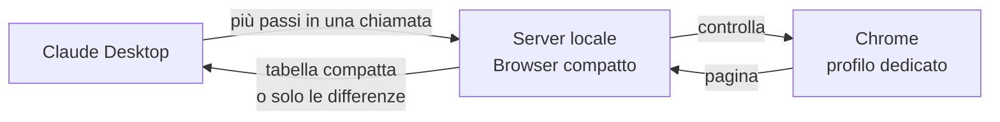

# Browser compatto per Claude Desktop

Estensione per Claude Desktop che fa navigare e compilare siti a Claude dentro Chrome **senza screenshot**: Claude riceve la pagina come una tabella compatta di testo, esegue molti passi in una sola chiamata e legge solo cosa è cambiato. Per i moduli basta passargli i dati: un piccolo motore locale, ispirato a Jev, abbina i campi da solo e chiede a Claude solo i casi incerti. Risultato: molti meno token e meno attesa, con qualsiasi piano Claude e senza chiave API.

### [⬇ Scarica l'ultima versione (compact-browser.mcpb)](https://github.com/t4zxxx1/compact-browser-mcp/releases/latest/download/compact-browser.mcpb)

Tutte le versioni: [Releases](https://github.com/t4zxxx1/compact-browser-mcp/releases)

---

## Installazione

1. Serve **Claude Desktop** (Windows o macOS) e **Google Chrome** o **Microsoft Edge**.
2. Scarica `compact-browser.mcpb` dal link sopra e aprilo con doppio clic: Claude Desktop chiede conferma e installa. In alternativa: Claude Desktop → Impostazioni → Estensioni → installa da file.
3. Facoltativo, nelle impostazioni dell'estensione: limita i siti consentiti (es. `servizi.lavoro.gov.it, fondimpresa.it`).

Al primo utilizzo si apre una finestra di Chrome con un **profilo dedicato**, separato da quello personale. Gli accessi (SPID, CIE, password) si fanno a mano in quella finestra una volta sola e restano salvati.

## Come si usa

Basta chiedere a Claude, ad esempio:

- *"Con il browser compatto apri il portale X e compila la domanda con questi dati: …"*
- *"Apri l'elenco progetti e leggimi le edizioni del progetto PF-2026-115"*
- *"Quanti token hai usato finora col browser?"*

Se è attivo anche Claude in Chrome, conviene dire esplicitamente *"usa il browser compatto"*.

## Come funziona

Descrizione completa di architettura, tool, passi, motore dei compiti guidati, sicurezza e limiti: [docs/come-funziona.md](docs/come-funziona.md).



1. **Un piccolo server sul tuo PC.** L'estensione avvia un server locale (Node.js, già incluso in Claude Desktop) che comanda Chrome tramite Playwright. Nessun dato passa da server di terzi.
2. **La pagina diventa testo compatto.** Uno script dentro la pagina raccoglie solo ciò che serve per agire: campi, menu, pulsanti, link, caselle, con nome, valore, stato (obbligatorio, non valido, disattivato) e un'indicazione se l'azione è delicata. Ogni elemento diventa una riga. Menu, intestazioni e piè di pagina vengono compressi; le righe di tabella ripetute vengono riassunte.
3. **Molti passi in una sola chiamata.** Claude manda un elenco di passi (compila, scegli, spunta, clicca, aspetta, leggi) che può proseguire anche dopo un cambio pagina, perché gli elementi si indicano anche per nome. Il server li esegue uno dopo l'altro e aspetta che la pagina sia stabile (DOM fermo e nessuna richiesta di rete in corso).
4. **Solo le differenze.** Dopo i passi Claude non rilegge la pagina intera: riceve i campi verificati, gli elementi nuovi o cambiati, gli errori del modulo e il testo comparso (es. "Domanda inviata, protocollo n. …").
5. **Compiti guidati.** Con `browse_task` Claude non deve nemmeno guardare il modulo: passa i dati con le etichette dell'utente (`"P.IVA": "01234567890"`, `"data inizio": "03/11/2026"`) e il motore locale decide quale campo è quale, con una probabilità calibrata. Sopra la soglia agisce, sotto chiede. Dettagli e numeri: [docs/calibrazione.md](docs/calibrazione.md).

Perché si risparmia: uno screenshot costa circa 1.366 token, quanto un modulo intero di 30 campi in formato testo; e ogni chiamata in meno evita di far rileggere a Claude tutta la conversazione.

### Cosa vede Claude

Output reale su una pagina di prova (estratto, le righe omesse sono indicate con `…`):

```
http://127.0.0.1:8811/domanda1.html | Nuova domanda - passo 1 di 2
h1: Richiesta di contributo per piano formativo · scroll 0/1747
[fs "Dati dell'azienda"]
e28 text "Ragione sociale" req
e31 sel "Codice ATECO" ="Seleziona" opz:97 req
e33 sel "Provincia" ="Seleziona prima la regione" off req
e34 combo "Comune" req col
…
[fs "Dichiarazioni"]
e54 chk "Dichiaro di aver letto l'informativa privacy e accetto il t…" [ ] req !c
[form "domanda"]
e56 btn "Salva bozza" !c
e57 btn "Avanti"
[hdr,search,nav,ftr nascosti: 73 elementi; scope:"all" o filter per vederli]
```

Dopo 22 passi in una sola chiamata (campi, menu dipendenti, autocompletamento del comune), la risposta completa è:

```
ok 22/22
---
http://127.0.0.1:8811/domanda1.html · 16 campi impostati come richiesto · 5 altre variazioni
~ e31 "Codice ATECO" ="62 - Industrie alimentari (62)" req
~ e32 "Regione" ="Campania" req
~ e33 "Provincia" ="Napoli" req
~ e34 "Comune" ="Pozzuoli" req col
~ e46 "Fonte di finanziamento" ="Fondo Nuove Competenze" req
```

### Un compito guidato

Output reale. Claude manda i 21 dati con le etichette dell'utente (`"P.IVA"`, `"ateco": "62"`, `"comune": "Ischia"`, `"data inizio": "03/11/2026"`…) senza aver visto la pagina:

```
parametri: 21/21 impostati
obbligatori ancora vuoti: e54 "Dichiaro di aver letto l'informativa privacy e accetto il t…" !c, e55 "Dichiaro che i dati forniti sono veritieri ai sensi del DPR…" !c
cookie rifiutati (Rifiuta)
"P.IVA" → e29 "Partita IVA" 97%
"ateco" → e31 "Codice ATECO" ="62 - Industrie alimentari (62)"
"provincia" → e33 "Provincia" 93%
"data inizio" → e49 "Data inizio" (data adattata: 2026-11-03)
---
http://127.0.0.1:8811/domanda1.html | Nuova domanda - passo 1 di 2
pulsanti: e56 "Salva bozza" !c · e57 "Avanti"
```

Le righe con la freccia sono i casi da segnalare (confidenza sotto il 97%, opzione del menu o formato della data adattati); gli altri 17 campi sono stati abbinati con confidenza di almeno il 97%. Le dichiarazioni sono `!c`: Claude chiede l'ok all'utente e le spunta nella chiamata successiva. Dopo l'invio confermato:

```
inviato: "Invia domanda" → "Conferma invio"
atteso "Protocollo": si
protocollo = "2026/004512" (78%, da testo)
```

## Novità della versione 0.2

- **`browse_task`**: compiti in stile Jev. Abbinamento dei dati ai campi con confidenza calibrata, domande solo per i casi incerti, memoria per sito delle risposte, menu dipendenti, autocompletamenti, date adattate al formato del campo, invio protetto, verifica (`expect`) ed estrazione tipizzata (`extract`: testo, numero, importo, data, URL, tabella).
- **Più lingue**: riconoscimento di invio, conferme, consensi, password, carte e banner dei cookie in italiano, inglese, francese, spagnolo, tedesco e portoghese.
- **Pulsanti a sola icona**: nome dedotto dall'icona (`~elimina`, `~modifica`), con la stessa protezione `!c`.
- **Overlay**: flag `cop` sugli elementi coperti da banner o finestre fisse.
- **Canvas e mappe**: clic a coordinate relative `{x, y}` (0-1) con controllo di cosa c'è sotto il punto; screenshot con i ref disegnati sopra (`labels`) o di una sola regione; `describe` restituisce la posizione dell'elemento.
- **Nomi approssimati**: un target con un refuso viene risolto per somiglianza e la risposta riporta la percentuale; sotto la soglia non agisce e propone i più vicini.

## Sicurezza

- **`!c` azioni con effetti**: invio, conferma, salvataggio, eliminazione, pagamento, accettazione di termini e dichiarazioni, caricamento file, Invio che spedisce un modulo. Il server le blocca: Claude deve chiedere l'ok all'utente e ripetere il passo con conferma esplicita.
- **`!x` campi riservati**: password, numeri di carta, CVV, OTP, IBAN. Claude non può compilarli, nemmeno con conferma: li inserisce l'utente nella finestra. In `browse_task` un parametro che per nome è una credenziale viene rifiutato prima ancora di cercare il campo.
- **Compiti guidati**: il motore agisce da sé solo sopra la soglia di confidenza; consensi, invio e caricamenti restano `!c`, e l'invio non parte se ci sono domande aperte, errori o campi obbligatori vuoti.
- **Finestre di conferma del sito** (`confirm()`): annullate per default; accettarle richiede conferma.
- **Domini consentiti**: fuori dall'elenco Claude non può aprire pagine né agire.
- Bloccati `file://`, `javascript:` e ogni indirizzo che non sia http/https.
- I riferimenti agli elementi (`e123`) sono unici per tutta la sessione: un riferimento di una pagina precedente non può mai colpire un elemento diverso.
- Il testo delle pagine è trattato come contenuto non fidato, non come istruzioni.

## Impostazioni

| Impostazione | Default | Note |
|---|---|---|
| Domini consentiti | tutti | separati da virgola |
| Conferma per le azioni con effetti | attiva | consigliato lasciarla attiva |
| Cartella del profilo browser | `~/.compact-browser/profile` | qui restano accessi e cookie |
| Cartella download | Download | dove finiscono i file scaricati |
| Percorso di Chrome | automatico | solo se l'avvio non riesce |
| Browser invisibile | no | attivalo solo se non ti serve vedere la finestra |
| Consenti screenshot | sì | screenshot ridotto (~900 token) quando il testo non basta |

## Confronto con gli altri strumenti

Stessi compiti e stesse pagine per sette metodi: screenshot, Playwright MCP (Microsoft), agent-browser (Vercel) da riga di comando e via MCP, Fast Playwright MCP e il browser compatto, a passi espliciti e con `browse_task`. Tutti hanno completato tutti i compiti. Qui il compito più lungo: domanda su 2 pagine con 22 campi, menu dipendenti, autocompletamento, conferme e lettura del protocollo.

| Metodo | Dove si usa | Chiamate | Token delle pagine | Contesto riletto in totale | Tempo stimato |
|---|---|---|---|---|---|
| Screenshot | computer use | 54 | 74.304 | 2.480.688 | 154 s |
| agent-browser MCP | Claude Desktop | 40 | 16.943 | 1.373.730 | 108 s |
| Playwright MCP | Claude Desktop, Code | 14 | 23.421 | 318.910 | 52 s |
| Fast Playwright MCP | Claude Desktop, Code | 7 | 11.151 | 115.624 | 57 s |
| agent-browser CLI (senza caricare la guida) | Claude Code | 5 | 9.358 | 84.124 | 40 s |
| Browser compatto, passi espliciti | Claude Desktop | 4 | 1.191 | 41.690 | 24 s |
| **Browser compatto, `browse_task`** | **Claude Desktop** | **3** | **702** | **31.611** | **20 s** |

Una singola lettura del modulo costa 634 token con il browser compatto, contro 4.400-5.300 con gli strumenti ad albero di accessibilità; con `browse_task` Claude non ha bisogno di leggerlo. Sui compiti brevi (elenco → dettaglio, navigazione) i metodi a blocchi si avvicinano; il browser compatto resta il più leggero in token e con `browse_task` la navigazione si chiude in una sola chiamata.

Le pagine di prova sono state costruite durante lo sviluppo di questo strumento, che quindi gioca in casa. Tabelle complete, ipotesi, problemi riscontrati negli altri strumenti e limiti del confronto: [docs/benchmark.md](docs/benchmark.md).

## Limiti noti

- Funziona in Claude Desktop, non in claude.ai web né nell'app mobile (è un'estensione locale).
- Grafici, canvas e mappe non hanno testo: per quelli Claude usa lo screenshot ridotto (anche con i ref disegnati sopra) e il clic a coordinate.
- Il motore di `browse_task` conosce un dizionario di sinonimi, non un modello addestrato: con termini di settore che non conosce chiede più spesso (sulla pagina di prova indipendente ha deciso da solo il 55% dei casi, sempre correttamente). Le risposte vengono ricordate per sito.
- CAPTCHA e accessi li fa l'utente nella finestra.
- I campi data in sola lettura (calendari a comparsa) vengono impostati via script: il tool lo segnala perché il portale potrebbe non accettarli.
- Testato su pagine di prova costruite sul modello dei portali istituzionali; segnalate nelle [Issues](https://github.com/t4zxxx1/compact-browser-mcp/issues) i siti reali che non funzionano.

## Per sviluppatori

```bash
npm ci            # dipendenze di sviluppo e del server
npm test          # oltre 120 test end-to-end via protocollo MCP (Chrome o Edge installato)
npm run bench     # confronto con screenshot, Playwright MCP, agent-browser, Fast Playwright MCP
npm run calibrate # calibrazione del motore di browse_task (docs/calibrazione.md)
npm run build     # crea dist/compact-browser.mcpb
```

Struttura: `extension/` (manifest, icona, server MCP; il motore è in `server/lib/engine.js` e `server/lib/task.js`), `test/` (pagine di prova, test, benchmark, calibrazione), `scripts/build.mjs`.

Nuova versione: aggiorna `version` in `package.json`, `extension/manifest.json` ed `extension/server/package.json`, poi `git tag v0.3.0 && git push --tags`. GitHub Actions esegue i test, crea il `.mcpb` e lo pubblica nella release; il link di download in cima resta sempre lo stesso.

## Licenza

MIT, vedi [LICENSE](LICENSE). © 2026 Roca Software.
