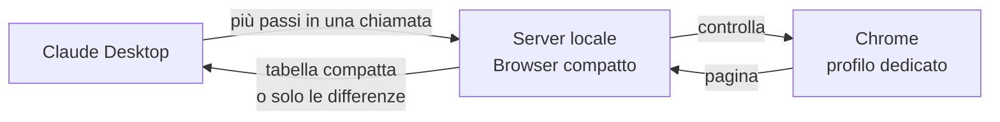

# Browser compatto per Claude Desktop

Estensione per Claude Desktop che fa navigare e compilare siti a Claude dentro Chrome **senza screenshot**: Claude riceve la pagina come una tabella compatta di testo, esegue molti passi in una sola chiamata e legge solo cosa è cambiato. Risultato: molti meno token e meno attesa, con qualsiasi piano Claude e senza chiave API.

### [⬇ Scarica l'ultima versione (compact-browser.mcpb)](https://github.com/t4zxxx1/compact-browser-mcp/releases/latest/download/compact-browser.mcpb)

Tutte le versioni: [Releases](https://github.com/t4zxxx1/compact-browser-mcp/releases)

---

## Installazione

1. Serve **Claude Desktop** (Windows o macOS) e **Google Chrome** o **Microsoft Edge**.
2. Scarica `compact-browser.mcpb` dal link sopra e aprilo con doppio clic: Claude Desktop chiede conferma e installa. In alternativa: Claude Desktop → Impostazioni → Estensioni → installa da file.
3. Facoltativo, nelle impostazioni dell'estensione: limita i siti consentiti (es. `servizi.lavoro.gov.it, fondimpresa.it`).

Al primo utilizzo si apre una finestra di Chrome con un **profilo dedicato**, separato da quello personale. Gli accessi (SPID, CIE, password) si fanno a mano in quella finestra una volta sola e restano salvati.

## Come si usa

Basta chiedere a Claude, ad esempio:

- *"Con il browser compatto apri il portale X e compila la domanda con questi dati: …"*
- *"Apri l'elenco progetti e leggimi le edizioni del progetto PF-2026-115"*
- *"Quanti token hai usato finora col browser?"*

Se è attivo anche Claude in Chrome, conviene dire esplicitamente *"usa il browser compatto"*.

## Come funziona



1. **Un piccolo server sul tuo PC.** L'estensione avvia un server locale (Node.js, già incluso in Claude Desktop) che comanda Chrome tramite Playwright. Nessun dato passa da server di terzi.
2. **La pagina diventa testo compatto.** Uno script dentro la pagina raccoglie solo ciò che serve per agire: campi, menu, pulsanti, link, caselle, con nome, valore, stato (obbligatorio, non valido, disattivato) e un'indicazione se l'azione è delicata. Ogni elemento diventa una riga. Menu, intestazioni e piè di pagina vengono compressi; le righe di tabella ripetute vengono riassunte.
3. **Molti passi in una sola chiamata.** Claude manda un elenco di passi (compila, scegli, spunta, clicca, aspetta, leggi) che può proseguire anche dopo un cambio pagina, perché gli elementi si indicano anche per nome. Il server li esegue uno dopo l'altro e aspetta che la pagina sia stabile (DOM fermo e nessuna richiesta di rete in corso).
4. **Solo le differenze.** Dopo i passi Claude non rilegge la pagina intera: riceve i campi verificati, gli elementi nuovi o cambiati, gli errori del modulo e il testo comparso (es. "Domanda inviata, protocollo n. …").

Perché si risparmia: uno screenshot costa circa 1.366 token, quanto un modulo intero di 30 campi in formato testo; e ogni chiamata in meno evita di far rileggere a Claude tutta la conversazione.

### Cosa vede Claude

Output reale su una pagina di prova (estratto, le righe omesse sono indicate con `…`):

```
http://127.0.0.1:8811/domanda1.html | Nuova domanda - passo 1 di 2
h1: Richiesta di contributo per piano formativo · scroll 0/1747
[fs "Dati dell'azienda"]
e28 text "Ragione sociale" req
e31 sel "Codice ATECO" ="Seleziona" opz:97 req
e33 sel "Provincia" ="Seleziona prima la regione" off req
e34 combo "Comune" req col
…
[fs "Dichiarazioni"]
e54 chk "Dichiaro di aver letto l'informativa privacy e accetto il t…" [ ] req !c
[form "domanda"]
e56 btn "Salva bozza" !c
e57 btn "Avanti"
[hdr,search,nav,ftr nascosti: 73 elementi; scope:"all" o filter per vederli]
```

Dopo 22 passi in una sola chiamata (campi, menu dipendenti, autocompletamento del comune), la risposta completa è:

```
ok 22/22
---
http://127.0.0.1:8811/domanda1.html · 16 campi impostati come richiesto · 5 altre variazioni
~ e31 "Codice ATECO" ="62 - Industrie alimentari (62)" req
~ e32 "Regione" ="Campania" req
~ e33 "Provincia" ="Napoli" req
~ e34 "Comune" ="Pozzuoli" req col
~ e46 "Fonte di finanziamento" ="Fondo Nuove Competenze" req
```

## Sicurezza

- **`!c` azioni con effetti**: invio, conferma, salvataggio, eliminazione, pagamento, accettazione di termini e dichiarazioni, caricamento file, Invio che spedisce un modulo. Il server le blocca: Claude deve chiedere l'ok all'utente e ripetere il passo con conferma esplicita.
- **`!x` campi riservati**: password, numeri di carta, CVV, OTP, IBAN. Claude non può compilarli, nemmeno con conferma: li inserisce l'utente nella finestra.
- **Finestre di conferma del sito** (`confirm()`): annullate per default; accettarle richiede conferma.
- **Domini consentiti**: fuori dall'elenco Claude non può aprire pagine né agire.
- Bloccati `file://`, `javascript:` e ogni indirizzo che non sia http/https.
- I riferimenti agli elementi (`e123`) sono unici per tutta la sessione: un riferimento di una pagina precedente non può mai colpire un elemento diverso.
- Il testo delle pagine è trattato come contenuto non fidato, non come istruzioni.

## Impostazioni

| Impostazione | Default | Note |
|---|---|---|
| Domini consentiti | tutti | separati da virgola |
| Conferma per le azioni con effetti | attiva | consigliato lasciarla attiva |
| Cartella del profilo browser | `~/.compact-browser/profile` | qui restano accessi e cookie |
| Cartella download | Download | dove finiscono i file scaricati |
| Percorso di Chrome | automatico | solo se l'avvio non riesce |
| Browser invisibile | no | attivalo solo se non ti serve vedere la finestra |
| Consenti screenshot | sì | screenshot ridotto (~900 token) quando il testo non basta |

## Confronto con il metodo normale

Stessi compiti, stesse pagine, tutti e tre i metodi completati con successo.

| Compito | Metodo | Chiamate | Token delle pagine | Contesto riletto in totale | Tempo stimato |
|---|---|---|---|---|---|
| Domanda su 2 pagine, 22 campi, conferme | Screenshot | 54 | 74.304 | 2.480.688 | 154 s |
| | Albero di accessibilità (Playwright MCP) | 14 | 23.421 | 318.910 | 51 s |
| | **Browser compatto** | **4** | **1.191** | **38.495** | **24 s** |
| Elenco → dettaglio progetto | Screenshot | 3 | 4.128 | 34.630 | 13 s |
| | Playwright MCP | 4 | 10.698 | 73.371 | 15 s |
| | **Browser compatto** | **2** | **1.101** | **22.026** | **11 s** |
| Home → elenco, leggere il totale | Screenshot | 2 | 2.752 | 23.809 | 10 s |
| | Playwright MCP | 4 | 12.301 | 69.739 | 15 s |
| | **Browser compatto** | **2** | **487** | **21.050** | **11 s** |

Sui moduli lunghi il guadagno è grande (circa il 98% di token in meno rispetto agli screenshot e l'88% in meno di contesto rispetto a Playwright MCP); sui compiti brevi il tempo è simile e cambiano soprattutto i token. Metodo, ipotesi e limiti del confronto: [docs/benchmark.md](docs/benchmark.md).

## Limiti noti

- Funziona in Claude Desktop, non in claude.ai web né nell'app mobile (è un'estensione locale).
- Grafici, canvas e mappe non hanno testo: per quelli Claude usa lo screenshot ridotto.
- CAPTCHA e accessi li fa l'utente nella finestra.
- I campi data in sola lettura (calendari a comparsa) vengono impostati via script: il tool lo segnala perché il portale potrebbe non accettarli.
- Testato su pagine di prova costruite sul modello dei portali istituzionali; segnalate nelle [Issues](https://github.com/t4zxxx1/compact-browser-mcp/issues) i siti reali che non funzionano.

## Per sviluppatori

```bash
npm ci            # dipendenze di sviluppo e del server
npm test          # 74 test end-to-end via protocollo MCP (Chrome o Edge installato)
npm run bench     # confronto con screenshot e Playwright MCP
npm run build     # crea dist/compact-browser.mcpb
```

Struttura: `extension/` (manifest, icona, server MCP), `test/` (pagine di prova, test, benchmark), `scripts/build.mjs`.

Nuova versione: aggiorna `version` in `package.json`, `extension/manifest.json` ed `extension/server/package.json`, poi `git tag v0.2.0 && git push --tags`. GitHub Actions esegue i test, crea il `.mcpb` e lo pubblica nella release; il link di download in cima resta sempre lo stesso.

## Licenza

MIT, vedi [LICENSE](LICENSE). © 2026 Roca Software.
