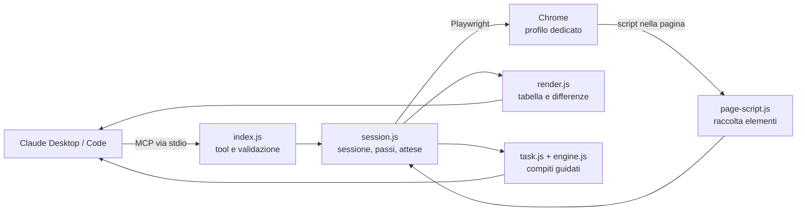

# Browser compatto: cosa fa e come funziona

Documento di riferimento sul server MCP **compact-browser** (versione 0.2.x): cosa offre a Claude, come è costruito dentro, come si comporta sulle pagine, come si misura e dove ha limiti. Per l'installazione e l'uso quotidiano vedi il [README](../README.md); per i numeri del confronto con altri strumenti [benchmark.md](benchmark.md); per la calibrazione del motore dei compiti guidati [calibrazione.md](calibrazione.md).

## 1. In una frase

Un server MCP locale che fa usare a Claude un vero Chrome **senza screenshot**: la pagina diventa una tabella di testo con un elemento per riga, Claude manda molti passi in una sola chiamata, riceve indietro solo ciò che è cambiato e, per i moduli, può passare i dati con le etichette dell'utente lasciando a un motore locale la scelta del campo giusto.

Obiettivo: meno token, meno chiamate, meno attesa, nessuna chiave API e nessun dato verso terzi.

## 2. Architettura



| File | Ruolo |
|---|---|
| `extension/server/index.js` | Registra i 7 tool MCP, validazione degli argomenti (zod), istruzioni per Claude, un solo comando alla volta (coda seriale). |
| `extension/server/lib/session.js` | Avvio di Chrome con profilo dedicato, esecuzione dei passi, attese di stabilità, sicurezza (`!c`, `!x`, domini), statistiche. |
| `extension/server/lib/page-script.js` | Codice che gira dentro la pagina: trova campi, menu, pulsanti, link, ne deduce nome, stato e sensibilità. |
| `extension/server/lib/render.js` | Trasforma gli elementi in righe di testo e calcola le differenze tra due viste. |
| `extension/server/lib/engine.js` | Motore decisionale locale: abbinamento dati→campi con probabilità calibrate, scelta di opzioni, date, estrazione tipizzata. |
| `extension/server/lib/task.js` | Ciclo di `browse_task`: osserva, decide, agisce, verifica, chiede solo i casi incerti. |
| `extension/manifest.json` | Pacchetto `.mcpb` per Claude Desktop e impostazioni dell'utente. |

Tutto gira sul tuo PC: Node.js (già incluso in Claude Desktop) comanda Chrome tramite `playwright-core`. Non c'è nessun servizio esterno.

## 3. I sette tool

| Tool | A cosa serve |
|---|---|
| `browse_open` | Apre un URL, rifiuta i cookie non necessari e restituisce la tabella degli elementi. |
| `browse_view` | Tabella della pagina attuale. `filter` per cercare un testo, `scope: "all"` per includere menu, intestazioni e piè di pagina, `offset` per la pagina successiva. |
| `browse_do` | Esegue **fino a 40 passi in una chiamata** e restituisce solo le variazioni. È il tool principale. |
| `browse_read` | Legge senza agire: `text` (paginato), `table`, `find` (righe che contengono un testo), `describe` (dettaglio e posizione di un elemento). |
| `browse_task` | Compito guidato: Claude passa i dati con le etichette dell'utente e il motore locale decide campi, menu, autocompletamenti e date. |
| `browse_screenshot` | Immagine ridotta (~900 token) solo quando il testo non basta (grafici, canvas, layout). `labels: true` disegna i riferimenti sopra gli elementi. |
| `browse_stats` | Token stimati usati nella sessione e confronto con il metodo a screenshot. |

Flusso consigliato a Claude (scritto nelle istruzioni del server): `browse_open` → leggere la tabella → `browse_do` con **tutti** i passi prevedibili in una chiamata (anche dopo un cambio pagina, usando i nomi) e in coda `find`/`read` per leggere l'esito → leggere solo il diff.

## 4. Come la pagina diventa testo

Uno script iniettato nella pagina raccoglie solo ciò che serve per agire. Ogni elemento diventa una riga:

```
e31 sel "Codice ATECO" ="Seleziona" opz:97 req
e54 chk "Dichiaro di aver letto l'informativa privacy…" [ ] req !c
e56 btn "Salva bozza" !c
```

- **Riferimento** (`e31`): id unico per tutta la sessione. Un riferimento di una pagina precedente non può mai colpire un elemento diverso.
- **Ruolo**: `btn link text area sel chk rad sw date num file pwd combo menu tab opt edit clk`.
- **Nome**: dall'etichetta, dai testi accessibili, dal contesto; per i pulsanti a sola icona viene dedotto (`~elimina`, `~modifica`).
- **Valore e stato**: `=valore`, `[x]`/`[ ]`, e i flag `req` obbligatorio, `inv` non valido, `off` disattivo, `ro` sola lettura, `exp`/`col` espanso/chiuso, `on` selezionato, `cop` coperto da un overlay.
- **Sensibilità**: `!c` azione con effetti, `!x` campo riservato, `!p` dato personale.

Per tenere la tabella piccola: menu e piè di pagina compressi (nascosti salvo `scope: "all"`), opzioni dei menu lunghi riassunte (97 codici ATECO diventano `opz:97`), nessun nodo strutturale, righe ripetute di tabella riassunte. Una lettura di un modulo di 22 campi costa circa 634 token.

Se c'è una finestra modale aperta, la tabella mostra **solo gli elementi della finestra**: è ciò con cui l'utente può interagire.

## 5. I passi di `browse_do`

Un passo = un verbo. I bersagli sono riferimenti (`e12`), testi del nome, oppure `{name, role, row, n}` per i casi ambigui (ad esempio un pulsante "Visualizza" in una riga di tabella) o `{x, y}` in coordinate 0-1 per canvas e mappe.

| Verbo | Cosa fa |
|---|---|
| `click` | Clic; con `force` via script se un elemento sovrapposto lo blocca. |
| `fill` | Sostituisce il contenuto del campo. Per i campi data nativi si usa `AAAA-MM-GG`. |
| `type` | Digita tasto per tasto (autocompletamenti). Se il clic apre una finestra e sposta il cursore, aspetta e scrive nel campo giusto. |
| `select` | Menu `<select>` nativo, scelta per etichetta, valore o parte. |
| `check` | Casella o radio (`on: false` per togliere). |
| `press` | Tasto (Invio, Tab, Esc, frecce); l'Invio che spedisce un modulo è `!c`. |
| `pick` | Clic sul suggerimento o sull'opzione visibile con quel testo (per menu personalizzati e autocompletamenti). |
| `hover`, `scroll` | Passaggio del mouse, scorrimento (`down`, `up`, `top`, `bottom` o verso un elemento). |
| `wait`, `waitFor` | Attesa fissa (max 10 s) o attesa che compaia un testo **visibile** (default 15 s, `timeout` in ms per accorciare). |
| `goto`, `back`, `tab` | Navigazione, indietro, schede (`list`, `close`, numero). |
| `upload`, `dialog` | Caricamento file e finestre di conferma del sito (richiedono `confirm`). |
| `find`, `read` | Leggono il testo dell'esito senza una chiamata a parte. |

### Come aspetta la pagina

Dopo ogni azione il server aspetta che la pagina sia **stabile**: documento caricato, DOM fermo da un breve intervallo, nessuna richiesta di rete in corso (escluse quelle aperte da oltre 4 secondi) e un tempo minimo per intercettare le navigazioni ritardate. I tempi sono limitati: i campi di autocompletamento aspettano al massimo qualche secondo, le altre azioni meno. Così Claude non deve aggiungere attese a mano.

### Come risponde

Dopo i passi il server non rilegge la pagina intera, ma riporta:

- `ok N/M` e il primo passo fallito (si ferma al primo errore o blocco);
- `N campi impostati come richiesto` (valori verificati dopo la scrittura);
- `~` righe cambiate, `+` nuove, `-` rimosse;
- `»` testo comparso (ad esempio "Domanda inviata, protocollo n. …") e `!` avvisi del modulo;
- le note di `find`/`read` richieste in coda.

Se la pagina cambia (navigazione o finestra), restituisce la vista completa nuova.

## 6. Compiti guidati (`browse_task`)

È l'equivalente locale di un "System One": un motore decisionale piccolo e rapido affianca Claude. Claude manda i dati con le etichette dell'utente:

```json
{ "params": { "P.IVA": "01234567890", "data inizio": "03/11/2026", "comune": "Ischia" }, "submit": "Avanti" }
```

Il ciclo per ogni compito:

1. **Osserva**: raccoglie la pagina (senza mostrarla a Claude).
2. **Decide**: per ogni dato calcola una probabilità per ciascun campo. Il punteggio combina somiglianza dell'etichetta (sinonimi, refusi, altre lingue), compatibilità del valore con il tipo di campo (data, numero, testo), memoria delle risposte già date su quel sito e piccoli bonus (obbligatorio, contesto del gruppo). I punteggi diventano probabilità con una softmax a temperatura calibrata e c'è sempre l'opzione "nessuno" (nessun campo).
3. **Agisce** solo se la confidenza supera la soglia del preset:

| Preset | Agisce da sola sopra | Zona intermedia | Note |
|---|---|---|---|
| `cautious` | 0,90 | 0,70 con margine 0,30 | pochi rischi, più domande |
| `balanced` (default) | 0,85 | 0,55 con margine 0,25 | |
| `autonomous` | 0,60 | 0,20 con margine 0,10 | nei pareggi tra suggerimenti sceglie il primo |

4. **Localizza e controlla**: ritrova il campo anche se la pagina è stata ricostruita dopo un'azione (per nome, non solo per riferimento); controlla sensibilità (`!c`, `!x`) e campi obbligatori.
5. **Verifica e risponde**: riporta cosa ha impostato, le scelte con confidenza bassa, le domande per i casi incerti, i campi obbligatori ancora vuoti, e la verifica dell'esito (`expect`) e l'estrazione tipizzata (`extract`: testo, numero, importo, data, URL, tabella).

### Domande e risposte

Quando un dato è incerto il motore non indovina: elenca i candidati con le probabilità e Claude risponde con `answers`:

- per un **campo**: `{"luogo": "e45"}` (la risposta viene ricordata per quel sito);
- per un **autocompletamento con suggerimenti equivalenti** (città, aeroporto, stazione): `{"Da dove?": "Zurich Airport"}`, il testo (anche parziale) del suggerimento da scegliere.

Dopo una domanda sugli autocompletamenti il popup viene chiuso, così gli altri campi restano raggiungibili.

### Altre capacità

- **Menu dipendenti** (la provincia che si riempie dopo la regione): il motore attende che le opzioni compatibili compaiano.
- **Date**: adattate al formato del campo (`03/11/2026` → `2026-11-03` per un campo nativo, `TT.MM.JJJJ` per un modulo tedesco).
- **Radio**: sceglie l'opzione dal valore.
- **Più lingue**: riconosce invio, conferme, consensi, password, carte e banner dei cookie in italiano, inglese, francese, spagnolo, tedesco, portoghese.
- **Memoria per sito**: le risposte date restano in `site-memory.json` accanto al profilo.

## 7. Sicurezza

- **`!c` azioni con effetti** (invio, conferma, salvataggio, eliminazione, pagamento, accettazione di termini, caricamento file, Invio che spedisce un modulo): il server le **blocca**; Claude chiede l'ok all'utente e ripete il passo con `confirm: true`. L'invio di `browse_task` non parte con domande aperte, errori o campi obbligatori vuoti.
- **`!x` campi riservati** (password, carte, CVV, OTP, IBAN): non compilabili da Claude nemmeno con conferma; li inserisce l'utente nella finestra. In `browse_task` un dato che per nome è una credenziale viene rifiutato prima di cercare il campo.
- **Domini consentiti**: elenco facoltativo; fuori da esso non si apre né si agisce. Bloccati `file://`, `javascript:` e tutto ciò che non è http o https.
- **Finestre di conferma del sito** (`confirm()`): annullate per default; accettarle richiede conferma.
- **Il testo delle pagine è contenuto non fidato**: non viene eseguito come istruzione.
- **CAPTCHA e accessi** (SPID, CIE, password): li fa l'utente nella finestra, una volta; restano nel profilo dedicato, separato da quello personale.

## 8. Impostazioni

| Impostazione | Default |
|---|---|
| Domini consentiti | tutti |
| Conferma per le azioni con effetti | attiva (consigliata) |
| Cartella del profilo | `~/.compact-browser/profile` |
| Cartella download | Download |
| Percorso di Chrome | automatico (Chrome o Edge) |
| Browser invisibile | no |
| Consenti screenshot | sì |

## 9. Come si misura

- `npm test`: test end-to-end via protocollo MCP reale su pagine di prova (`test/functional.mjs`, `resilience.mjs`, `v2.mjs`, `realsite.mjs`).
- `npm run bench`: stessi compiti con screenshot, Playwright MCP, agent-browser (CLI e MCP) e Fast Playwright MCP ([benchmark.md](benchmark.md)). Sul compito più lungo (domanda su due pagine, 22 campi) il browser compatto con `browse_task` usa 3 chiamate e 702 token di risposte, contro 5-54 chiamate e 9.358-74.304 token degli altri.
- `npm run calibrate`: calibrazione del motore ([calibrazione.md](calibrazione.md)).
- `browse_stats` in sessione: chiamate, azioni, osservazioni, screenshot, token prodotti dal tool e tempo nel browser.

Cosa questi numeri **non** dicono: le pagine di prova le ha costruite chi ha scritto il tool (gioca in casa) e gli agenti nel benchmark sono simulati; `browse_stats` conta solo i token restituiti dal tool, non quelli del modello che lo guida.

## 10. Limiti noti

- Funziona in Claude Desktop (e in Claude Code come MCP); non in claude.ai web né nell'app mobile.
- Grafici, canvas e mappe non hanno testo: serve lo screenshot ridotto e il clic a coordinate.
- Il motore di `browse_task` usa un dizionario di sinonimi, non un modello addestrato: con termini di settore sconosciuti chiede più spesso.
- Schede scorrevoli con le frecce, campi senza etichetta accessibile (ad esempio alcuni campi data) e riferimenti che cambiano dopo la ricostruzione della pagina sono i punti più delicati sui siti reali: per i campi senza nome si usa il riferimento o il bersaglio per ruolo e contesto.
- I campi data in sola lettura (calendari a comparsa) vengono impostati via script e il tool lo segnala.
- Non verificati con test dedicati: shadow root, frame annidati e scorrimenti annidati.

## 11. Correzioni dopo l'uso su siti reali

Provato su Google Flights, Wikipedia e il gestionale FNC sono emersi difetti che le pagine di prova non mostravano. Sono riprodotti da `test/realsite.mjs` (11 verifiche) e corretti:

| Difetto osservato | Causa | Correzione |
|---|---|---|
| `waitFor` in timeout dopo 15 s anche con il testo in pagina | prendeva la prima occorrenza, che può essere un elemento nascosto (menu chiuso, modello) | attende la prima occorrenza **visibile**; `timeout` configurabile; l'errore distingue "presente ma non visibile" da "non apparso" |
| `type` perdeva dei caratteri (`Zurich` → `ich`, poi `Zurch`) | il clic apriva una finestra e il cursore passava a un altro campo mentre si scriveva | dopo il clic aspetta che il cursore sia stabile in un campo modificabile (nessun ritardo sui campi normali), scrive e **verifica il valore**: se manca qualcosa riscrive tutto in un colpo |
| `browse_task` dichiarava "nessun suggerimento" su Google | i suggerimenti arrivano dalla rete dopo 1-3 s e il motore aspettava 2 s | attende fino a ~4 s, si ferma appena la lista è completa e stabile; se compare una finestra senza suggerimenti la chiude e segnala errore invece di dichiararsi riuscito |
| `browse_task` falliva sul secondo campo ("ref scaduto") | la scelta di un suggerimento ricostruisce la pagina e i riferimenti calcolati all'inizio non esistono più | il campo si ritrova **per nome** nella pagina nuova prima di agire |
| `browse_task` chiedeva all'utente tra "Zürich", "Zurich Airport", "Zürich HB" senza modo di rispondere | i suggerimenti equivalenti davano tutti lo stesso punteggio e `answers` accettava solo riferimenti | `answers` accetta il testo del suggerimento; il preset `autonomous` sceglie il primo dichiarandolo; dopo una domanda il popup viene chiuso |
| `expect` e `pick` potevano agganciarsi a copie nascoste | stessa causa di `waitFor` | filtro sui soli elementi visibili |
